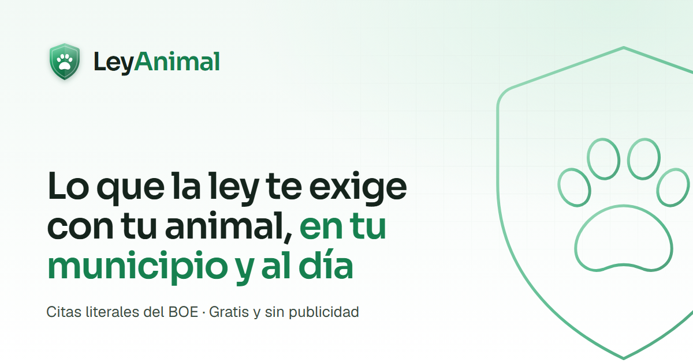

<div align="center">


# LeyAnimal

**Lo que la ley te exige con tu animal, en tu municipio y al día.**

Cada obligación, con su norma, su artículo, la cita literal y el enlace oficial.

[](https://github.com/ivangarmar22/LeyAnimal/actions/workflows/despliegue.yml)


[**Abrir la web**](https://leyanimal.es) ·
[Metodología](https://leyanimal.es/metodologia) ·
[Avisar de un error](https://leyanimal.es/colabora) ·
[Colaborar](https://leyanimal.es/apoya)



</div>

---

## Qué es

Tener un perro, un gato o un hurón en España implica obligaciones que vienen de
tres sitios a la vez: la Ley 7/2023 de bienestar animal, la ley de cada
comunidad autónoma y la ordenanza de cada ayuntamiento. Parte de la ley estatal
depende además de reglamentos que siguen sin publicarse.

LeyAnimal responde a una sola pregunta: **¿qué me exige a mí, hoy, donde vivo,
con este animal?** Y para cada obligación muestra:

- su **estado real**: obligatoria, pendiente de reglamento, recomendada, no
  aplica o sin datos verificados;
- el **ámbito** que la impone: estatal, autonómico o municipal;
- la **norma y el artículo**, con la **cita literal** y el enlace al boletín
  oficial;
- la **fecha** en que se verificó.

> [!NOTE]
> Es información divulgativa, no asesoramiento jurídico. Ante un caso concreto,
> consulta la norma enlazada, tu ayuntamiento o un profesional.

## Qué incluye

| Sección                      | Qué ofrece                                                            |
| ---------------------------- | --------------------------------------------------------------------- |
| **Consulta**                 | Cuatro pasos y el resultado de tu caso, con «¿Por qué me sale esto?»  |
| **Situaciones**              | Comprar o adoptar, mudarte, viajar por España o al extranjero…        |
| **Guías**                    | Seguro, identificación, curso, esterilización y perros peligrosos     |
| **Normativa**                | Explorador de normas con su ficha y sus artículos                     |
| **Comunidades y municipios** | 19 comunidades y ciudades autónomas, 52 provincias y 8.132 municipios |
| **Herramientas**             | Verificador de perros PPP, calculadora de multas, «Qué hacer si…»     |
| **Cambios**                  | Novedades normativas, también por RSS                                 |

Sin registro, sin cookies, sin analítica y sin publicidad.

## Cómo funciona

```
BOE e INE ──► scripts de contenido ──► src/datos/*.json ──► motor de reglas ──► páginas
                (citas literales)        (comprobados)        (TypeScript)       (estáticas)
```

- **Las citas no se escriben a mano.** Los scripts descargan el texto
  consolidado del BOE y extraen cada frase de su artículo. La comprobación
  falla si una cita no aparece literalmente en la norma o si el BOE anuncia una
  reforma que el consolidado aún no recoge.
- **Un motor de reglas** (`src/lib/reglas`) decide qué norma prevalece en cada
  territorio y por qué. Es TypeScript sin dependencias y tiene sus propios
  tests.
- **Todo es estático.** Astro genera las 8.286 páginas al compilar. Lo
  interactivo (la consulta, el buscador de municipios, el verificador) son islas
  de Preact que calculan en el navegador con el mismo motor. No hay servidor ni
  base de datos.

## Tecnología

[Astro 7](https://astro.build) · [Preact](https://preactjs.com) ·
[Tailwind CSS 4](https://tailwindcss.com) · TypeScript ·
[Vitest](https://vitest.dev) · [Lucide](https://lucide.dev) ·
[Fluent Emoji](https://github.com/microsoft/fluentui-emoji) ·
[Web3Forms](https://web3forms.com) para el formulario de avisos.

## Desarrollo

Requisitos: **Node.js 22.12 o superior** (se usa la 24) y **pnpm 11**, que
`corepack` activa con la versión exacta del proyecto.

```bash
corepack enable
pnpm install
cp .env.example .env.local
pnpm dev                     # http://localhost:4321
```

Para ver la versión de producción: `pnpm build` (alrededor de un minuto) y
`pnpm start`.

| Comando                  | Qué hace                                                    |
| ------------------------ | ----------------------------------------------------------- |
| `pnpm dev`               | Servidor de desarrollo                                      |
| `pnpm build`             | Genera el sitio estático en `dist/`                         |
| `pnpm start`             | Sirve el sitio compilado                                    |
| `pnpm verificar`         | Formato, contenido legal, lint, tipos y tests               |
| `pnpm test`              | Tests del motor de reglas                                   |
| `pnpm datos:comprobar`   | Comprueba fuentes, citas y referencias del contenido legal  |
| `pnpm datos:extraer`     | Descarga las leyes autonómicas del BOE                      |
| `pnpm datos:autonomicas` | Genera las citas autonómicas (`--escribir` para guardarlas) |
| `pnpm datos:referencia`  | Genera los artículos estatales de referencia                |
| `pnpm datos:geografia`   | Comunidades, provincias y municipios desde el INE           |
| `pnpm og`                | Regenera la imagen para compartir (necesita Chrome)         |
| `pnpm iconos`            | Descarga los iconos a color                                 |

> [!TIP]
> En Windows, el repositorio fuerza finales de línea LF (`.gitattributes`). Si
> `pnpm format:check` falla en todos los ficheros, normaliza la copia con
> `git add --renormalize .`.

## Estructura

```
src/pages/          Páginas, sitemaps, RSS y los JSON que descargan las islas
src/layouts/        Plantilla común: cabecera, pie y SEO
src/componentes/    Piezas .astro sin JavaScript
src/islas/          Componentes Preact que se hidratan en el navegador
src/ui/             Piezas Preact compartidas (chips, citas, tarjetas…)
src/datos/          Contenido legal y geográfico en JSON
src/lib/reglas/     Motor de reglas, con sus tests
src/lib/datos/      Acceso al contenido, evaluación y búsqueda
src/i18n/           Textos de la interfaz y su traductor
src/estilos/        Sistema de diseño (Tailwind 4)
scripts/contenido/  Generadores desde el BOE y el INE, y comprobaciones
docs/               Fichas de verificación legal y auditorías
```

Las decisiones de diseño y de criterio legal están en
[DECISIONES.md](DECISIONES.md).

## Contenido legal

Vive en `src/datos/`:

| Fichero                   | Origen                                              |
| ------------------------- | --------------------------------------------------- |
| `estatal.json`            | Normas estatales, requisitos, reglas y sus fuentes  |
| `autonomico.json`         | BOE, con `pnpm datos:autonomicas --escribir`        |
| `referencia-estatal.json` | BOE, con `pnpm datos:referencia`                    |
| `geografia.json`          | INE, con `pnpm datos:geografia`                     |
| `externas.json`           | Decretos que el BOE no recoge, copiados del boletín |
| `ppp.json`                | Razas y seguro de perros PPP de cada comunidad      |
| `catalogo.json`           | Especies, razas y temas                             |
| `cambios.json`            | Cambios normativos publicados                       |

**Regla fija:** ninguna afirmación legal entra en la web sin norma, artículo,
enlace oficial y fecha de verificación.

Para añadir una obligación autonómica:

1. Añade a `scripts/contenido/generar-autonomicas.mjs` la norma, el artículo,
   la frase que localiza la cita y las especies a las que se aplica.
2. Revisa la tabla con `pnpm datos:autonomicas` y guárdala con `--escribir`.
3. Ejecuta `pnpm datos:comprobar` y revisa el diff de los JSON.

Para refrescar el texto del BOE: `pnpm datos:extraer --actualizar` y
`pnpm datos:referencia --actualizar`.

## Despliegue

Cada push a `main` ejecuta [`despliegue.yml`](.github/workflows/despliegue.yml):
comprueba el proyecto con `pnpm verificar`, compila y publica `dist/` en GitHub
Pages.

La web se sirve en el dominio propio `leyanimal.es`, configurado en
_Settings › Pages_. Sus DNS (IONOS) apuntan a GitHub Pages: cuatro registros A
y cuatro AAAA en la raíz y un CNAME de `www` a `ivangarmar22.github.io`, según
la [guía de GitHub](https://docs.github.com/es/pages/configuring-a-custom-domain-for-your-github-pages-site).

La URL pública sale de `PUBLIC_SITE_URL` (variable del repositorio en
_Settings › Secrets and variables › Actions › Variables_). Admite subcarpeta,
por si la web volviera a publicarse sin dominio en
`https://ivangarmar22.github.io/LeyAnimal`.

El sitio compilado ocupa unos 450 MB, por debajo del límite de 1 GB de GitHub
Pages.

## Colaborar

- **¿Falta una ordenanza o hay un dato mal?** Usa
  [Avisar de un error](https://leyanimal.es/colabora) o
  abre un issue con el enlace a la norma oficial.
- **¿Te ha servido?** LeyAnimal es gratuito y altruista, y una parte de los donativos va a protectoras de animales. Si quieres, puedes
  [apoyar el proyecto](https://leyanimal.es/apoya) con un
  donativo.

## Créditos

Normas del [BOE](https://www.boe.es) y boletines autonómicos; municipios del
[INE](https://www.ine.es). Iconos de Lucide (ISC) y Fluent Emoji de Microsoft
(MIT). Tipografías Sora, Geist y Source Serif 4 (SIL OFL). Fotografía de
Robert Larsson en Unsplash.

---

<div align="center">
Hecho con cariño por <a href="https://github.com/ivangarmar22">Iván García</a> para quienes conviven con animales.
</div>
